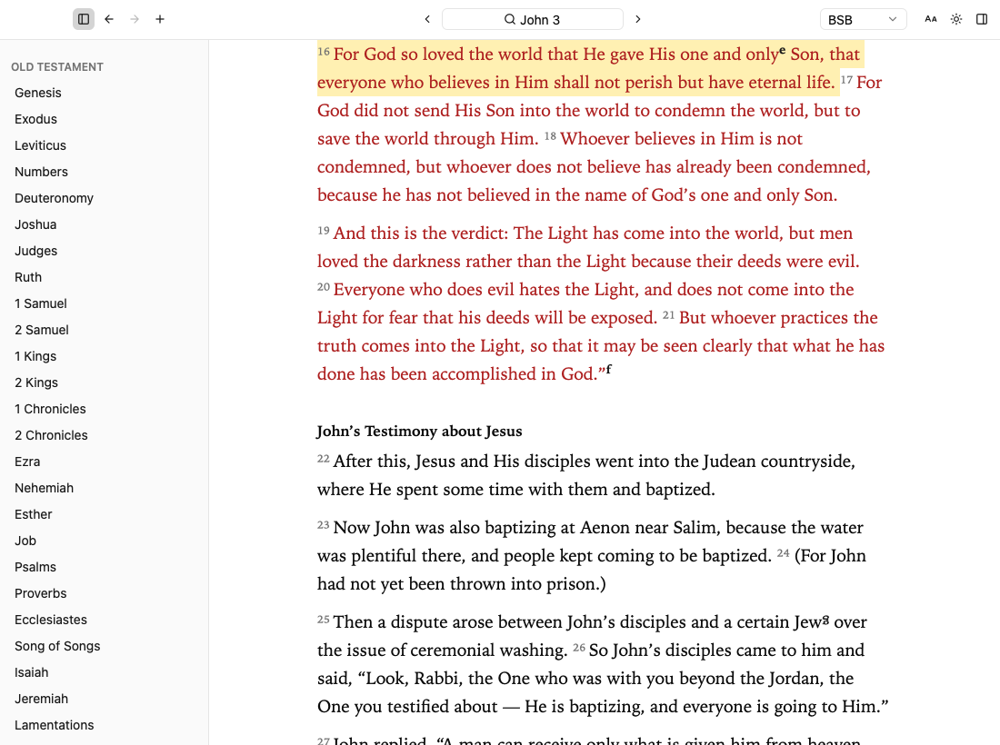
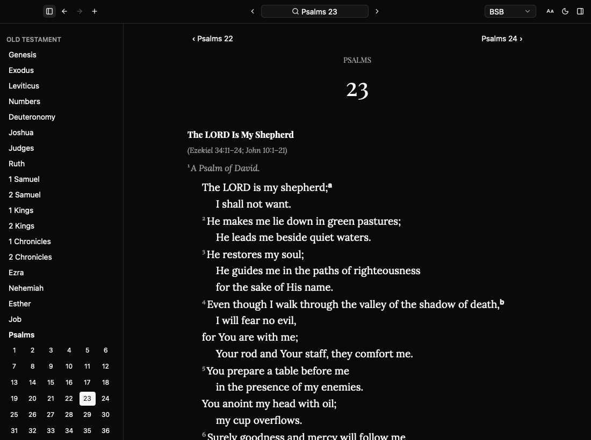
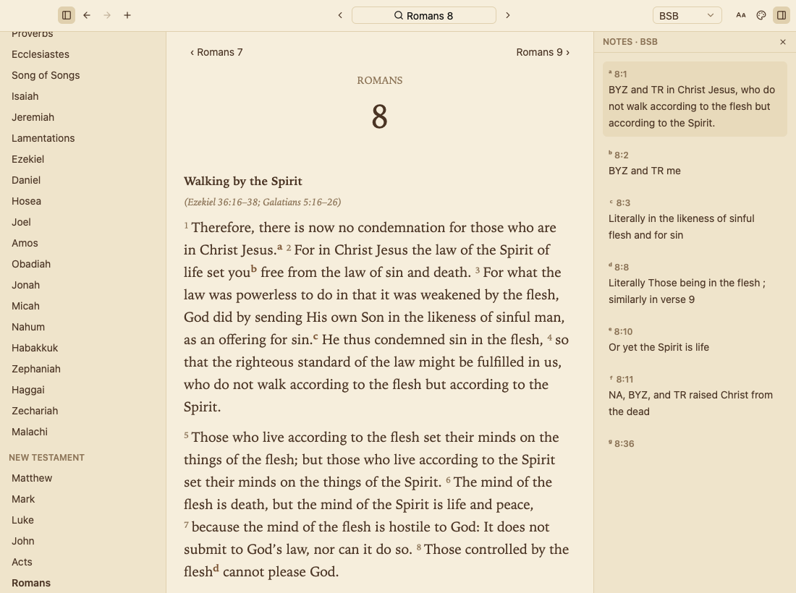
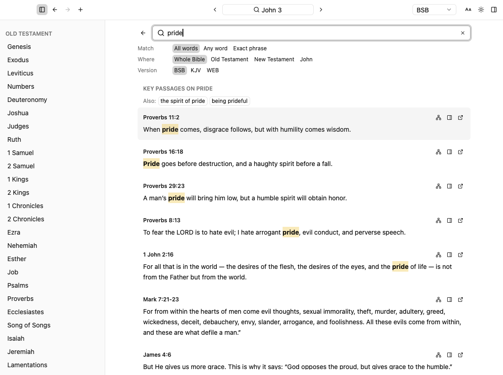
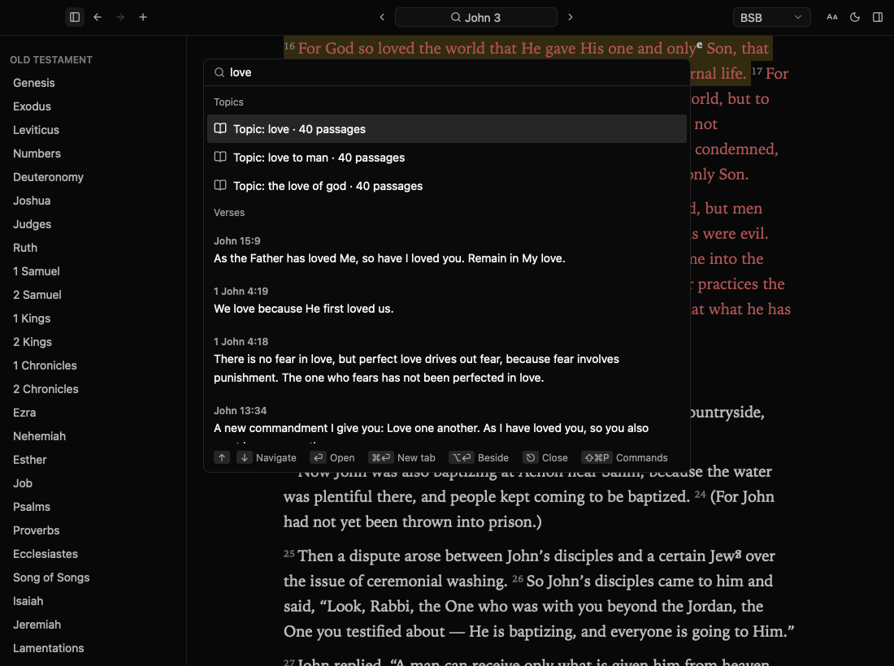
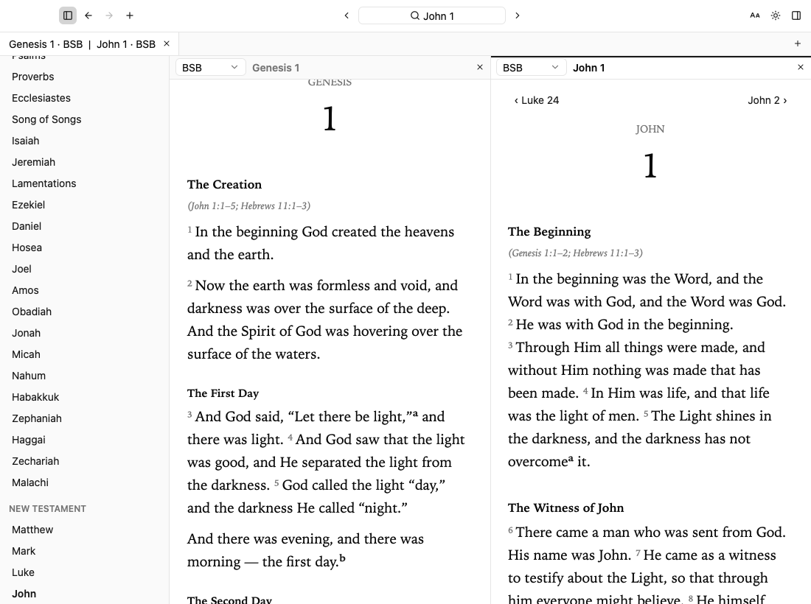

# Bible Reader

A fast, offline Bible reader for macOS, written in Rust. The whole interface is drawn on the GPU with [GPUI](https://www.gpui.rs) (the UI framework behind the [Zed](https://zed.dev) editor) and assembled from [gpui-kit](https://gpui-kit.com) components. There is no web view, no Electron and no network call anywhere in the app.



It ships with three public domain translations (BSB, KJV, WEB), a topical index built from three sources, and about 340,000 cross-references. All of it sits in local SQLite files.

## Why it's fast

Most Bible apps are a browser in a wrapper. This one is a native binary that talks to Metal directly, so there is nothing to boot and nothing to wait on.

- **Native rendering.** GPUI draws text and layout on the GPU. Scrolling a long chapter like Psalm 119 stays smooth, and switching themes or fonts is instant.
- **Search that answers while you type.** A cold first search takes about 50 ms in a release build. That covers the full pipeline: spelling correction, a porter-stemmed FTS5 index, topic matches, exact phrases and verse popularity.
- **Local data.** Each translation is one read-only SQLite file, and chapters are stored as ready-to-render blocks. Opening a passage is a single lookup.
- **Small.** The release binary is about 30 MB. The whole `.app`, with all three Bibles, the topical index and bundled fonts, is under 90 MB.
- **Keyboard first.** Press ⌘K, type `jn 3:16`, press Enter. You never have to touch the mouse.

## Screenshots

| Dark, with an editorial font pairing | Sepia, with the footnotes panel |
|---|---|
|  |  |

| Search by topic | The ⌘K palette |
|---|---|
|  |  |



## What it does

- **Go to anything.** The palette parses references like `jn 3:16`, `1 cor 13` or `ps 23`, and also searches words, tabs, recent chapters and commands. `in:nt` or `in:john` narrows a search.
- **Search that understands topics.** Search for `pride` and you get key passages from openbible.info, Nave's and Torrey's topical Bibles, followed by ranked verse matches. Misspellings are corrected before the search runs.
- **Tabs and split view.** Every tab keeps its own passage, translation and history. Drag a tab onto half of the text to read two chapters (or two translations) side by side.
- **Made for reading.** Red letter text, footnotes in a side panel, poetry indents, and six bundled font pairings. Light, Sepia, Dark or follow the system.
- **Menu bar companion.** The app stays in the menu bar after you close its window.

## Built on GPUI and gpui-kit

This project is also a working example of what a real desktop app looks like when you build it with GPUI and gpui-kit instead of hand-rolling widgets. The interface is almost entirely stock gpui-kit components:

| Part of the app | gpui-kit component |
|---|---|
| Toolbar in the window title bar | `TitleBar` |
| Buttons and icon buttons | `Button` |
| ⌘K palette with groups and shortcut hints | `Command` |
| Searchable translation picker | `Select` |
| Tab bar | `TabBar` |
| Theme and text size menus | `DropdownMenu` |
| Settings window | `setting` |
| Keyboard key caps | `Kbd` |

A few things worth knowing if you are evaluating GPUI:

- gpui-kit comes with a headless test harness, so the UI tests in `crates/app/src/reader.rs` click buttons, type into the palette and press keys without a display.
- `scripts/shot.sh` renders the real window offscreen with `Window::render_to_image()` and saves a PNG. Every screenshot above was made that way, with no Screen Recording permission and no focus stolen.
- Variable fonts don't pick weights on GPUI/macOS, so the bundled typefaces are static cuts.

## Install

You need macOS, Rust and the Xcode Command Line Tools. Full Xcode is not required, because gpui-kit compiles its Metal shaders at runtime.

```sh
# Rust (rust-toolchain.toml pins the version)
curl --proto '=https' --tlsv1.2 -sSf https://sh.rustup.rs | sh
. "$HOME/.cargo/env"
xcode-select --install

git clone https://github.com/bryaneaton13/bible-reader-desktop.git
cd bible-reader-desktop

cargo run --release -p bible-import   # USFM -> SQLite, about 15 s
cargo run --release -p app            # first build takes a few minutes
```

To build a real Mac app (release binary, translations and icon in one ad-hoc-signed bundle):

```sh
scripts/bundle.sh             # -> dist/Bible Reader.app
scripts/bundle.sh --install   # also copy to ~/Applications and launch it
```

## Keyboard shortcuts

Press ⌘/ in the app for the same list.

| Keys | Action |
|---|---|
| ⌘K / ⌘P (also ⌘L / ⌘F) | Palette: go to a passage, search words, switch tabs, run commands |
| ⇧⌘P | Palette with commands only (or type `>`) |
| ⇧⌘F | Search results page: topics, match mode, testament / book / version filters, related verses |
| ⌘T / ⌘W / ⇧⌘T | New tab / close tab / reopen closed tab |
| ⌃Tab / ⌃⇧Tab (or ⇧⌘] / ⇧⌘[) | Next / previous tab |
| ← / → (or ⌘[ / ⌘], ⌥← / ⌥→) | Previous / next chapter |
| ⌘\ / ⇧⌘\ | Split right (or unsplit) / close pane |
| ⌘⌥← / ⌘⌥→ | Focus left / right pane |
| ⌘Enter / ⌥Enter (in palette) | Open result in a new tab / beside the current one |
| ⌘B | Toggle sidebar |
| ⌥⌘B | Focus sidebar: arrows move, Enter opens, ⌥↑ / ⌥↓ change book, Esc returns |
| ⌃⌘← / ⌃⌘→ | Back / forward through history |
| ⌘1 … ⌘4 | Switch translation |
| ⌘+ / ⌘− / ⌘0 | Text size |
| ⌥⌘N | Toggle footnotes panel |
| ⇧⌘C / ⌥⌘C | Copy verse with citation / copy chapter |
| ⇧⌘L | Toggle dark mode (View ▸ Theme for Sepia and System) |
| ⌘, | Settings |
| ⌘/ | Keyboard shortcuts window (also Help menu and the palette) |
| ⇧⌘W / ⌘Q | Close window / quit |

Settings and your tabs are saved in `~/Library/Application Support/BibleReader/settings.json`.

## How it's put together

```
crates/
  bible-core/    domain types: books, verse IDs, reference parser, chapter content model (no UI, no DB)
  bible-store/   SQLite: one read-only DB per translation (FTS5 search), plus study.db (topics, cross-references)
  bible-import/  USFM parser and importer CLI
  app/           the GPUI app: reader window, tabs, ⌘K palette, notes panel, menu bar item
data/sources/    USFM inputs, topics, cross-references
scripts/         shot.sh (offscreen screenshots), bundle.sh (.app), make-icon.swift
docs/            product and architecture notes, roadmap
```

The three domain crates never depend on GPUI. `gpui-kit` is the only UI dependency of the app.

## Tests

```sh
cargo test --workspace                 # parser, store, importer, rendering, headless UI tests
cargo clippy --workspace --all-targets
```

## Credits and licenses

The code is released under the [MIT License](LICENSE). The data and fonts it ships with have their own terms:

- **UI:** [GPUI](https://www.gpui.rs) by the [Zed](https://zed.dev) team, through [gpui-kit](https://gpui-kit.com). The menu bar item uses [gpui-tray](https://crates.io/crates/gpui-tray).
- **Bible text:** the [Berean Standard Bible](https://berean.bible), the King James Version and the World English Bible (via [eBible.org](https://ebible.org)). All three are public domain.
- **Topics:** [openbible.info](https://www.openbible.info) topics and cross-references (CC-BY 4.0), and Nave's and Torrey's topical Bibles from the [Christian Classics Ethereal Library](https://ccel.org) (public domain).
- **Search:** [SQLite](https://sqlite.org) FTS5 through [rusqlite](https://github.com/rusqlite/rusqlite).
- **Fonts:** bundled typefaces under the SIL Open Font License, in `assets/fonts/`.

---

# For agents and contributors

If you are an AI agent (or a human who wants the full workflow), read [`AGENTS.md`](AGENTS.md) first. It covers the validation steps, the offscreen screenshot tool and the gotchas that cost time. [`CLAUDE.md`](CLAUDE.md) points Claude Code at the same file. Product and design notes are in [`docs/`](docs/README.md), and the roadmap in [`docs/05-roadmap.md`](docs/05-roadmap.md) shows what is done and what is next.

Quick checks before sending a change:

```sh
cargo test --workspace && cargo clippy --workspace --all-targets && cargo fmt --all
scripts/shot.sh /tmp/shot.png "jn 3:16" "sepia,notes"   # for any UI change, then look at the PNG
```
